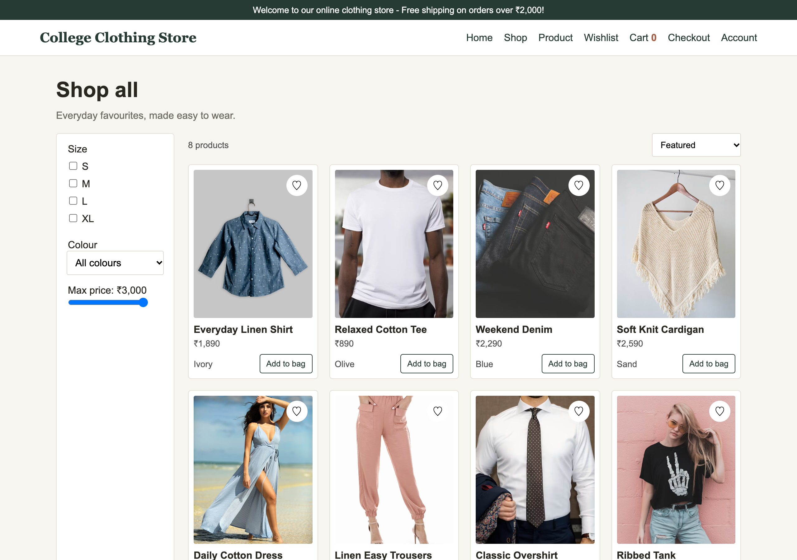
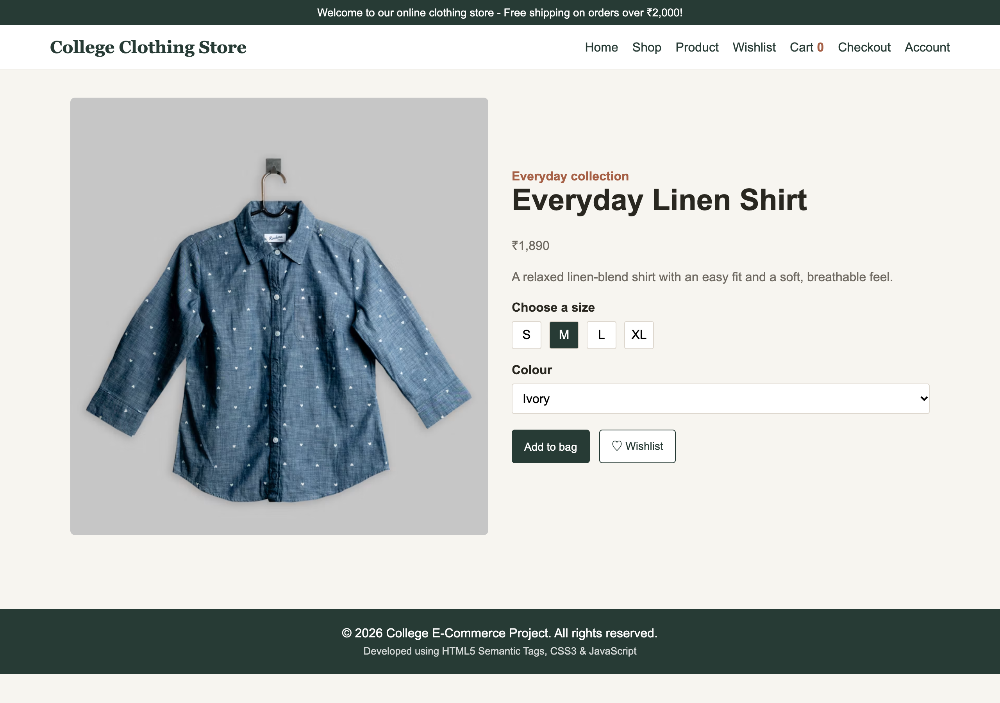
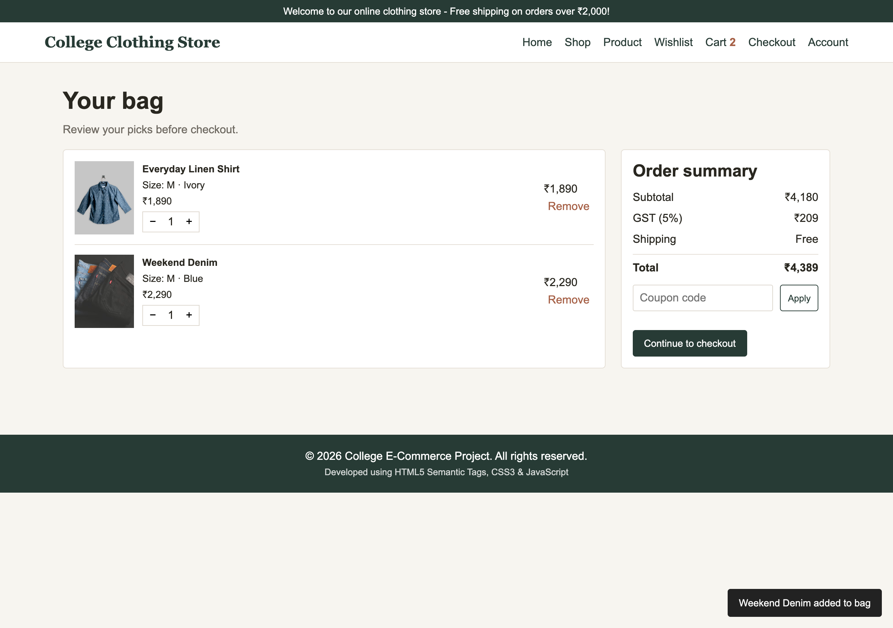
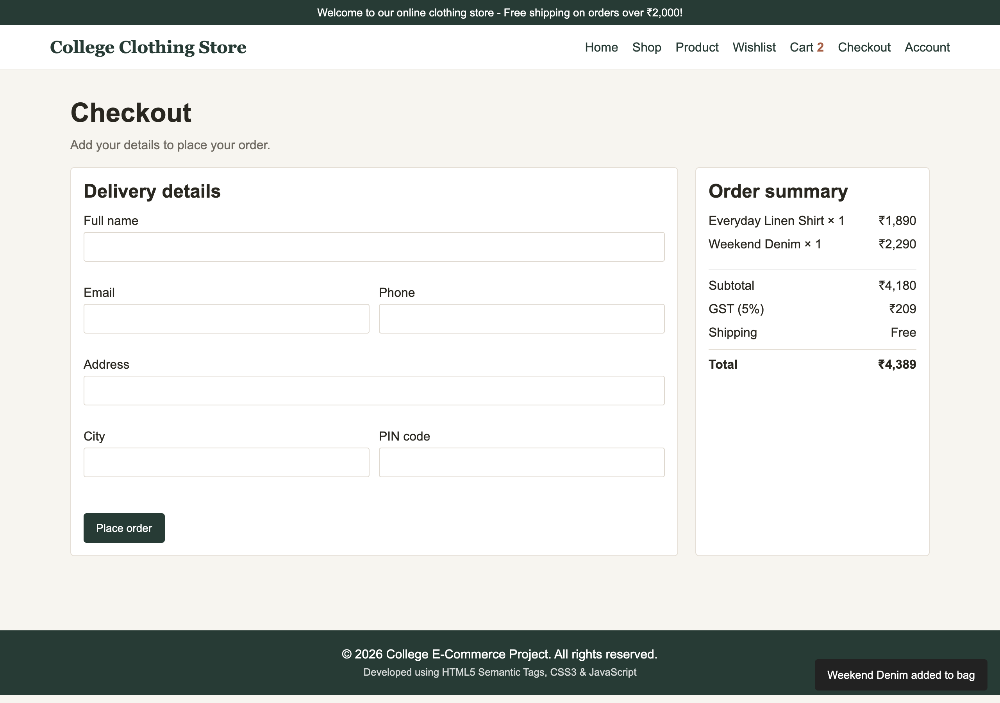
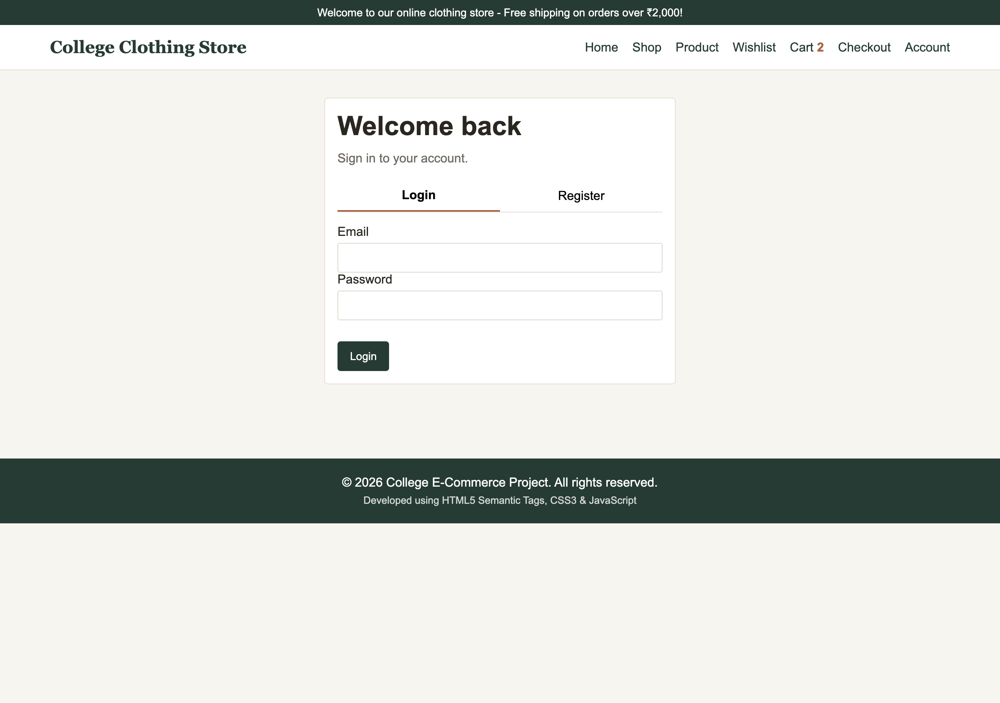
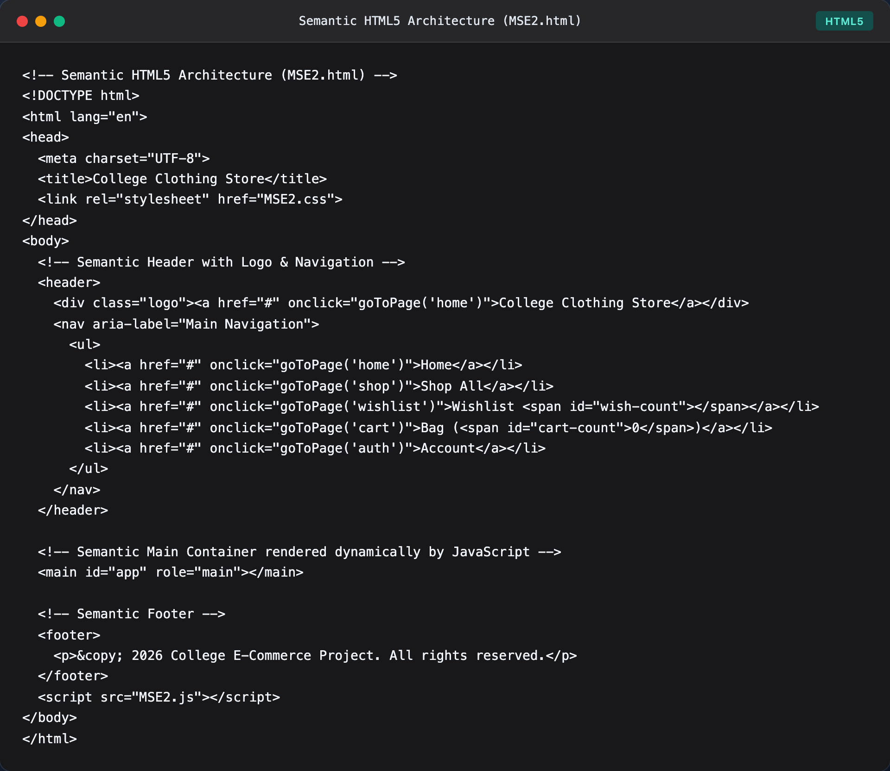
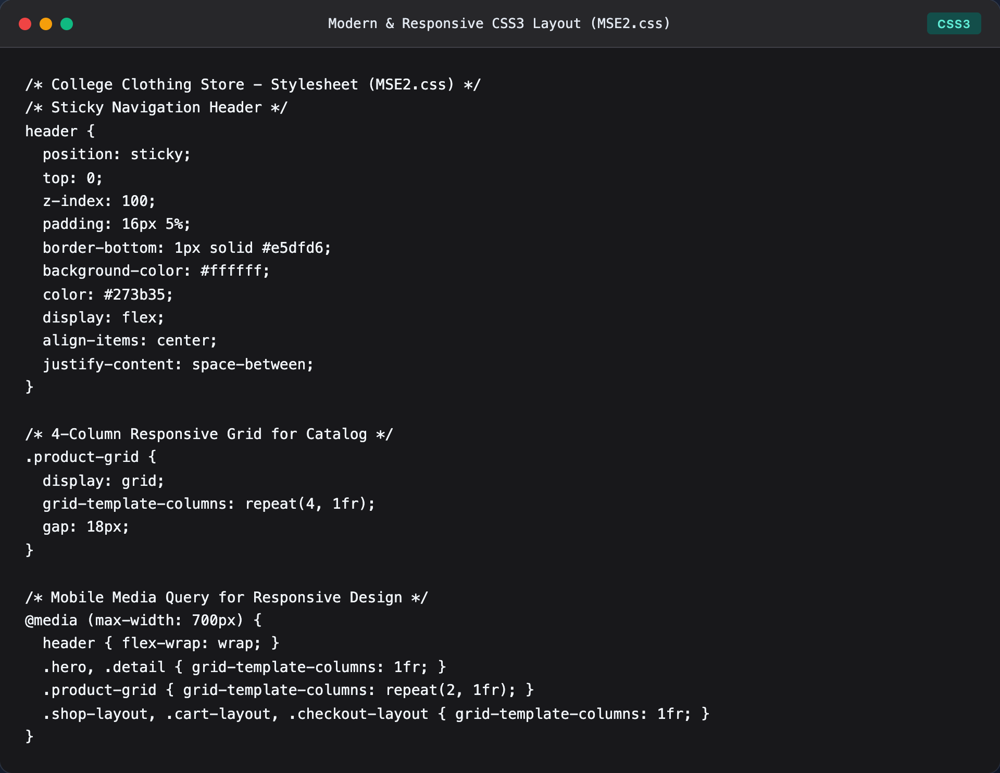
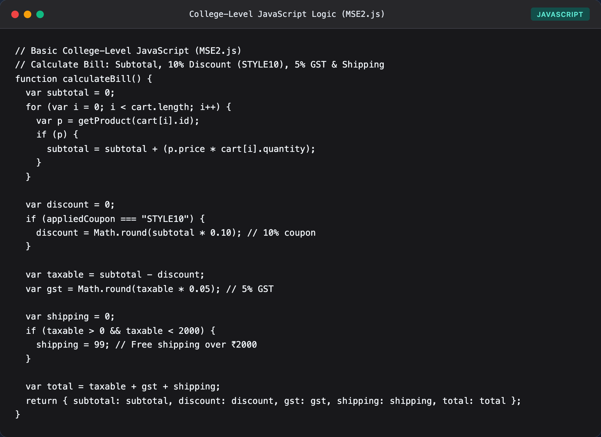

# College Clothing Store (MSE2)

An interactive e-commerce single-page web application developed for college web development evaluation using semantic HTML5, clean responsive CSS3, and beginner-friendly JavaScript.

## 🚀 Live Demo
- **Live Vercel Site:** [https://mse2ecomsite.vercel.app/](https://mse2ecomsite.vercel.app/)
- **GitHub Pages:** [https://sanskaar-tiwari.github.io/MSE2/](https://sanskaar-tiwari.github.io/MSE2/)

---

## 📸 Website Screenshots

### 1. Home Page & Hero Showcase
Welcome banner, announcement bar, navigation menu, and customer favourites grid.


### 2. Shop Catalog & Dynamic Filters
Product catalog with dynamic size checkboxes, colour dropdown, live price range slider, and sort order.


### 3. Product Detail View
Product presentation with interactive size picker (S, M, L, XL), color selection, Add to Bag, and Wishlist toggling.


### 4. Shopping Bag & Order Breakdown
Cart item management, quantity adjusters (+ / −), item removal, 10% coupon system (`STYLE10`), 5% GST, and free shipping calculation.


### 5. Delivery Details Checkout Form
Complete checkout workflow with input validation (Full name, Email with `@`, 10-digit Phone, Address, City, 6-digit PIN).


### 6. User Account (Login & Registration)
Interactive tabbed authentication form for logging in and creating a new student/shopper account.


---

## 💻 Source Code Snapshots

### 1. Semantic HTML5 Architecture (`MSE2.html`)
Built with standard HTML5 semantic elements (`<header>`, `<nav>`, `<ul>`, `<li>`, `<main>`, `<section>`, `<article>`, `<footer>`).


### 2. Responsive CSS3 Layout (`MSE2.css`)
Sticky navigation, Flexbox header, 4-column CSS Grid, and mobile media queries (`@media (max-width: 700px)`).


### 3. Textbook College-Level JavaScript (`MSE2.js`)
Clean, beginner-friendly JavaScript using standard `for` loops, regular `function` declarations, and `localStorage` persistence.


---

## 🛠️ Features & Practical Specifications
- **Single Page Architecture (SPA):** Seamless switching between Home, Shop, Product Detail, Wishlist, Cart, Checkout, and Auth without full-page reloads.
- **Product Filtering & Sorting:** Real-time filtering by price range slider (₹700 – ₹3,000), size, and color, plus sorting by price and newest arrivals.
- **Cart & Wishlist Engine:** Add to bag, quantity increment/decrement, dynamic subtotal, coupon code `STYLE10` (10% off), 5% GST, and free shipping over ₹2,000.
- **Delivery Validation:** Client-side validation ensuring valid phone numbers (10 digits), PIN codes (6 digits), and email formatting.
- **LocalStorage Persistence:** Cart and wishlist items automatically save to the browser and persist across page refreshes.

---

## 📂 Project Structure
```
MSE2/
├── MSE2.html          # Main HTML document with semantic HTML5 tags
├── index.html         # Root index for GitHub Pages & Vercel deployment
├── MSE2.css           # Responsive stylesheet with Flexbox & CSS Grid
├── MSE2.js            # Basic college-level JavaScript logic & DOM manipulation
├── vercel.json        # Deployment configuration for Vercel
├── screenshots/       # Website previews and code card snapshots
└── README.md          # Project documentation with visual gallery
```
